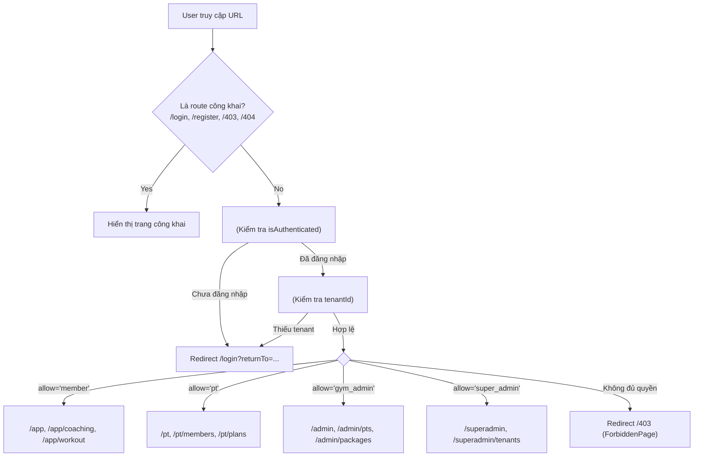

# Chi Tiết Frontend: GymManagement_UI Codebase

> **Tài liệu bộ nhớ ngữ cảnh AI Agent (Context Memory)** — Phân hệ Frontend ứng dụng quản lý phòng gym & huấn luyện AI.
>
> **Được cập nhật:** 2026-09-19 | **Đường dẫn thư mục:** `d:\SEP\GymManagement_UI\`

---

## 1. Tech Stack Frontend

Toàn bộ thư viện và công cụ được khai báo cụ thể tại [package.json](file:///d:/SEP/GymManagement_UI/package.json):

| Hạng mục | Thư viện / Công nghệ | Phiên bản | Vai trò trong dự án |
|---|---|---|---|
| **Core Framework** | React + React DOM | `^19.0.0` | Thư viện xây dựng giao diện người dùng |
| **Ngôn ngữ** | TypeScript | `~5.6.3` | Strict mode bật toàn bộ, không dùng `any` |
| **Build Tool & Bundler** | Vite | `^8.2.1` | Native alias `resolve.tsconfigPaths`, build siêu tốc |
| **Router** | React Router DOM | `^7.1.1` | Định tuyến khai báo (Data Router) với Guard phân tầng |
| **Client State** | Zustand | `^5.0.2` | Quản lý Auth session, Theme, và Local UI State |
| **Server State / Cache** | TanStack React Query | `^5.62.7` | Caching, deduplication, invalidation dữ liệu API |
| **Form & Validation** | React Hook Form + Zod | `^7.54.1` / `^3.24.1` | Xử lý form, kết nối qua `@hookform/resolvers/zod` |
| **Styling & CSS** | Tailwind CSS + PostCSS | `^3.4.17` | Utility-first CSS, CSS variables cho theming |
| **UI Primitives** | Radix UI | `^1.1` - `^2.1` | Dialog, Dropdown, Label, Slot, Tabs headless |
| **Icons & Notification** | Lucide React + Sonner | `^0.468` / `^1.7.1` | Bộ icon SVG hiện đại và thông báo Toast |
| **Quốc tế hóa (i18n)** | i18next + react-i18next | `^24.1.0` / `^15.2.0` | Hỗ trợ song ngữ tiếng Anh (`en`) và tiếng Việt (`vi`) |
| **Mock Network** | MSW (Mock Service Worker) | `^2.7.0` | Chặn network layer trên trình duyệt và trong unit tests |
| **Unit Testing** | Vitest + Testing Library | `^4.1.9` / `^16.1.0` | Chạy kiểm thử đơn vị và component |
| **E2E Testing** | Playwright | `^1.49.1` | Chạy kiểm thử luồng người dùng trên trình duyệt thật |

---

## 2. Cấu Trúc Thư Mục Feature-Sliced Design (FSD)

Dự án áp dụng chặt chẽ kiến trúc **Feature-Sliced Design** với quy tắc phụ thuộc một chiều:
```
app → pages → features → entities → shared
```

```
src/
├── app/                        # Shell ứng dụng & bootstrap
│   ├── providers/              # QueryProvider, PortalLayout
│   ├── router/                 # Cấu hình router & các tầng Guards (Auth, Tenant, Role)
│   └── App.tsx                 # Root Component (ErrorBoundary + QueryProvider + Router + Toaster)
├── pages/                      # Các trang theo Route (THIN — chỉ gom cụm Features)
│   ├── auth/                   # LoginPage, RegisterPage, ForgotPasswordPage, ResetPasswordPage
│   ├── member/                 # MemberDashboardPage, MemberWorkoutPage, coaching/CoachingPlanPage
│   ├── pt/                     # PTDashboardPage, PTMembersPage, PTSchedulePage
│   ├── admin/                  # AdminDashboardPage, AdminPtsPage, AdminPackagesPage
│   ├── superadmin/             # SuperAdminDashboardPage, SuperAdminTenantsPage, SuperAdminAnalyticsPage
│   ├── ForbiddenPage.tsx       # Trang 403
│   ├── NotFoundPage.tsx        # Trang 404
│   └── ComingSoonPage.tsx      # Placeholder cho các tính năng đang phát triển
├── features/                   # Các lát cắt nghiệp vụ độc lập (Vertical Slices)
│   ├── auth/                   # Đăng nhập, đăng ký, store auth, form validation
│   ├── coaching/               # AI Coaching (Kế hoạch tập/dinh dưỡng, Check-in dialog)
│   ├── camera-assessment/      # Đánh giá tư thế bài tập qua camera (Stub)
│   ├── pt-management/          # Quản lý PT & học viên (Stub)
│   ├── membership/             # Mua gói & check-in phòng tập (Stub)
│   ├── gamification/           # Điểm thưởng, streaks, huy hiệu (Stub)
│   └── wearable/               # Đồng bộ thiết bị đeo (Stub)
├── entities/                   # Định nghĩa Domain Type thuần TypeScript (KHÔNG chứa React UI)
│   ├── user/                   # AuthUser, Role, AuthSession, LoginPayload
│   ├── plan/                   # CoachingPlan, WorkoutPlan, Exercise, NutritionPlan, CheckIn
│   ├── checkin/                # CheckIn entity & payload
│   ├── member/                 # MemberProfile, OnboardingPayload
│   ├── trainer/                # TrainerProfile, TrainerPackage
│   ├── gym/                    # Tenant, Gym
│   ├── package/                # MembershipPackage, PurchaseRecord
│   └── session/                # ExerciseSession, SessionResult
├── shared/                     # Mã tái sử dụng toàn cục (Pure Cross-Cutting)
│   ├── api/                    # client.ts (Axios), endpoints.ts, errorTypes.ts
│   ├── config/                 # constants.ts (ROUTES, STORAGE_KEYS), env.ts, queryClient.ts
│   ├── hooks/                  # useTheme, useMediaQuery, useDebouncedValue
│   ├── lib/                    # cn.ts, errorNotifier.ts
│   ├── types/                  # Type tiện ích dùng chung
│   └── ui/                     # Button, Card, Dialog, Empty, Input, Label, Skeleton, Tabs, Toast...
├── i18n/                       # Cấu hình i18next & thư mục ngôn ngữ locales/{en,vi}
├── mocks/                      # Cấu hình MSW browser worker & handlers
├── styles/                     # globals.css (Tailwind & CSS Variables)
├── test/                       # Thiết lập môi trường Vitest (setup.ts)
└── main.tsx                    # Điểm khởi động ứng dụng (Hydrate session & Start MSW)
```

---

## 3. Định Tuyến & Cơ Chế Phân Quyền (Routing & Guards)

Hệ thống định tuyến được cấu hình tại [src/app/router/index.tsx](file:///d:/SEP/GymManagement_UI/src/app/router/index.tsx) với mô hình phân cấp Guard:



### Bảng định nghĩa Route tập trung ([src/shared/config/constants.ts](file:///d:/SEP/GymManagement_UI/src/shared/config/constants.ts)):
- **Public:** `/login`, `/register`, `/forgot-password`, `/reset-password`, `/403`, `/404`
- **Member:** `/app`, `/app/coaching`, `/app/workout`, `/app/nutrition`, `/app/progress`
- **PT:** `/pt`, `/pt/members`, `/pt/plans`
- **Gym Admin:** `/admin`, `/admin/pts`, `/admin/packages`
- **Super Admin:** `/superadmin`, `/superadmin/tenants`, `/superadmin/analytics`

---

## 4. Quản Lý Trạng Thái (State Management Strategy)

Dự án phân tách dữ liệu rõ ràng theo các công cụ chuyên trách:

| Loại dữ liệu | Nơi lưu trữ | Công cụ sử dụng | File mẫu tham chiếu |
|---|---|---|---|
| **Server Data (Kế hoạch, Check-in, Danh sách)** | Cache mạng | **TanStack React Query** | [useCoaching.ts](file:///d:/SEP/GymManagement_UI/src/features/coaching/model/useCoaching.ts) |
| **Auth Session & User Profile** | Client Store + `sessionStorage` | **Zustand** (`useAuthStore`) | [useAuthStore.ts](file:///d:/SEP/GymManagement_UI/src/features/auth/model/useAuthStore.ts) |
| **Form Values & Validation Errors** | Cục bộ Component | **React Hook Form + Zod** | [CheckInDialog.tsx](file:///d:/SEP/GymManagement_UI/src/features/coaching/ui/CheckInDialog.tsx) |
| **Theme & Dark Mode** | DOM Class + Local Storage | **Zustand / useTheme hook** | [useTheme.ts](file:///d:/SEP/GymManagement_UI/src/shared/hooks/useTheme.ts) |
| **Bộ lọc & Phân trang URL** | URL Query String | `useSearchParams` | Theo dõi trên từng trang |

> **Quy tắc cấm (Anti-patterns):**
> 1. Không copy dữ liệu server từ React Query vào Zustand.
> 2. Không lưu Token vào `localStorage` (tránh rủi ro bảo mật XSS, tuân thủ `SSR-AA-04`).
> 3. Không dùng `useEffect` để fetch dữ liệu; luôn dùng query hooks.

---

## 5. Tầng Giao Tiếp API (API Client & Interceptors)

Được cài đặt trong [src/shared/api/client.ts](file:///d:/SEP/GymManagement_UI/src/shared/api/client.ts):

### Tính năng cốt lõi của Axios Client:
1. **Tự động gắn Headers (Request Interceptor):**
   - `Authorization: Bearer <accessToken>` từ `TokenManager`.
   - `X-Tenant-Id: <tenantId>` từ `sessionStorage`.
   - `Idempotency-Key: <UUIDv4>` cho mọi phương thức `POST`, `PUT`, `PATCH`, `DELETE`.
2. **Tự động Unpack Envelope:**
   - Các hàm `apiGet<T>`, `apiPost<T>`, `apiPut<T>`, `apiPatch<T>`, `apiDelete<T>` tự unwrap JSON Envelope `{ data: T }` để trả về trực tiếp kiểu dữ liệu `T`.
3. **Cơ chế Token Refresh Đồng Thời (Concurrent 401 Queue):**
   - Khi token hết hạn, request đầu tiên kích hoạt gọi `/auth/refresh`.
   - Các request 401 tiếp theo được đưa vào `refreshQueue` chờ nhận token mới thay vì spam nhiều request refresh.
4. **Phân cấp lỗi có kiểu (Typed Error Hierarchy):**
   - Phân biệt rõ ràng `AuthError`, `ValidationError` (kèm `fieldErrors`), `NetworkError`, và `ApiError` ([errorTypes.ts](file:///d:/SEP/GymManagement_UI/src/shared/api/errorTypes.ts)).

---

## 6. Kiến Trúc Component & Design System

### Triết lý thiết kế UI:
- Không dùng thư viện UI nặng (như AntD hay MUI), sử dụng hướng tiếp cận **shadcn-style** kết hợp **Radix UI headless** và **Tailwind CSS**.
- Bộ sưu tập components cơ bản tại `src/shared/ui/`:
  - [button/Button.tsx](file:///d:/SEP/GymManagement_UI/src/shared/ui/button/Button.tsx): Biến thể `default`, `destructive`, `outline`, `secondary`, `ghost`, `link` với các kích thước `default`, `sm`, `lg`, `icon`.
  - [card/Card.tsx](file:///d:/SEP/GymManagement_UI/src/shared/ui/card/Card.tsx): Gồm `Card`, `CardHeader`, `CardTitle`, `CardDescription`, `CardContent`, `CardFooter`.
  - [dialog/Dialog.tsx](file:///d:/SEP/GymManagement_UI/src/shared/ui/dialog/Dialog.tsx): Hộp thoại Modal dựng trên `@radix-ui/react-dialog`.
  - [error-boundary/ErrorBoundary.tsx](file:///d:/SEP/GymManagement_UI/src/shared/ui/error-boundary/ErrorBoundary.tsx): Bắt lỗi cục bộ tại từng Layout/Guard, tránh làm trắng trang.
  - [empty/EmptyState.tsx](file:///d:/SEP/GymManagement_UI/src/shared/ui/empty/EmptyState.tsx), [skeleton/Skeleton.tsx](file:///d:/SEP/GymManagement_UI/src/shared/ui/skeleton/Skeleton.tsx), [toast/Toaster.tsx](file:///d:/SEP/GymManagement_UI/src/shared/ui/toast/Toaster.tsx) (Sonner).

### Hệ thống Màu Sắc & Tokens ([src/styles/globals.css](file:///d:/SEP/GymManagement_UI/src/styles/globals.css)):
- Định nghĩa qua HSL CSS Variables:
  - `--primary`: Xanh lá thể thao (`142 71% 45%` - HSL green).
  - `--background`, `--foreground`, `--card`, `--muted`, `--accent`, `--destructive`, `--border`.
- Hỗ trợ giao diện sáng / tối (**Light / Dark mode**) thông qua class `.dark` trên thẻ `<html>`.
- Phông chữ chuẩn: `Inter`, system fonts.

---

## 7. Các Trang & Tính Năng Đã Triển Khai

| Khu vực | Trang / Thành phần | Đường dẫn file | Trạng thái & Tính năng |
|---|---|---|---|
| **Xác thực** | `LoginPage` | [LoginPage.tsx](file:///d:/SEP/GymManagement_UI/src/pages/auth/LoginPage.tsx) | Đăng nhập tài khoản, gợi ý 4 demo accounts, tự chuyển hướng theo vai trò |
| **Xác thực** | `RegisterPage` | [RegisterPage.tsx](file:///d:/SEP/GymManagement_UI/src/pages/auth/RegisterPage.tsx) | Đăng ký tài khoản hội viên |
| **Xác thực** | `ForgotPasswordPage` & `ResetPasswordPage` | [ForgotPasswordPage.tsx](file:///d:/SEP/GymManagement_UI/src/pages/auth/ForgotPasswordPage.tsx) | Khôi phục mật khẩu qua token |
| **Hội viên** | `MemberCoachingPage` | [CoachingPlanPage.tsx](file:///d:/SEP/GymManagement_UI/src/pages/member/coaching/CoachingPlanPage.tsx) | **Vertical Slice hoàn chỉnh:** Xem giáo án tập & dinh dưỡng ([PlanCard.tsx](file:///d:/SEP/GymManagement_UI/src/features/coaching/ui/PlanCard.tsx)), mở Dialog Check-in ([CheckInDialog.tsx](file:///d:/SEP/GymManagement_UI/src/features/coaching/ui/CheckInDialog.tsx)) |
| **Hội viên** | `MemberDashboardPage` | [MemberDashboardPage.tsx](file:///d:/SEP/GymManagement_UI/src/pages/member/MemberDashboardPage.tsx) | Khung Dashboard hội viên |
| **Layout** | `PortalLayout` | [PortalLayout.tsx](file:///d:/SEP/GymManagement_UI/src/app/providers/PortalLayout.tsx) | Shell chung có Header, Sidebar điều hướng theo role, chuyển ngữ i18n, nút chuyển theme, đăng xuất |
| **PT / Admin** | Các trang PT & Admin | `src/pages/pt/`, `src/pages/admin/`, `src/pages/superadmin/` | Khung layout chuẩn bị sẵn với `ComingSoonPage` |

---

## 8. Quy Ước Code Frontend (Frontend Standards)

1. **Quy tắc Barrel Export:**
   - Khi import từ một feature: Luôn import từ `src/features/<name>`, tuyệt đối không import sâu như `src/features/<name>/ui/Component`.
2. **Quy tắc đặt tên (Naming Convention):**
   - React Components: `PascalCase.tsx`
   - Custom Hooks: `use*.ts` (VD: `useCoaching.ts`, `useAuth.ts`)
   - Stores: `use*Store.ts` (VD: `useAuthStore.ts`)
   - Utility functions: `camelCase.ts` (VD: `cn.ts`, `errorNotifier.ts`)
3. **i18n Namespace Convention:**
   - Dùng hook `useTranslation('namespace')`.
   - Các namespaces hiện có: `auth`, `coaching`, `common`, `errors`.
   - Khi thêm mới một từ khóa, **bắt buộc cập nhật đồng thời** cả 2 file `src/i18n/locales/en/<ns>.json` và `src/i18n/locales/vi/<ns>.json`.
4. **Xử lý Accessibility (a11y):**
   - Đặt `aria-labelledby` và `data-testid` trên các vùng landmark quan trọng.
   - Form inputs luôn gắn `Label` tương ứng qua thuộc tính `htmlFor` và `id`.

---

## 9. Các Lệnh Chạy & Kiểm Thử (Scripts)

| Lệnh npm | Mô tả hành động |
|---|---|
| `npm run dev` | Khởi chạy Vite dev server (mặc định tại `http://localhost:5173`) |
| `npm run build` | Kiểm tra kiểu bằng `tsc -b` và đóng gói bundle bằng Vite |
| `npm run preview` | Chạy preview bản build production |
| `npm run typecheck` | Kiểm tra lỗi kiểu dữ liệu TypeScript không sinh file (`tsc -b --noEmit`) |
| `npm run lint` | Chạy ESLint kiểm tra lỗi với điều kiện nghiêm ngặt `--max-warnings=0` |
| `npm run lint:fix` | Tự động sửa các lỗi ESLint có thể fix |
| `npm run format` | Chạy Prettier định dạng toàn bộ mã nguồn |
| `npm run format:check`| Kiểm tra định dạng code bằng Prettier |
| `npm run test` | Chạy toàn bộ Unit và Component tests bằng Vitest |
| `npm run test:watch` | Chạy Vitest ở chế độ theo dõi file thay đổi (watch mode) |
| `npm run test:coverage`| Chạy Vitest và xuất báo cáo độ bao phủ mã nguồn (coverage) |
| `npm run e2e` | Chạy bộ kiểm thử E2E (End-to-End) bằng Playwright |
| `npm run e2e:ui` | Mở giao diện trực quan của Playwright Test Runner |
| `npm run msw:init` | Khởi tạo worker `mockServiceWorker.js` vào thư mục `public/` |
